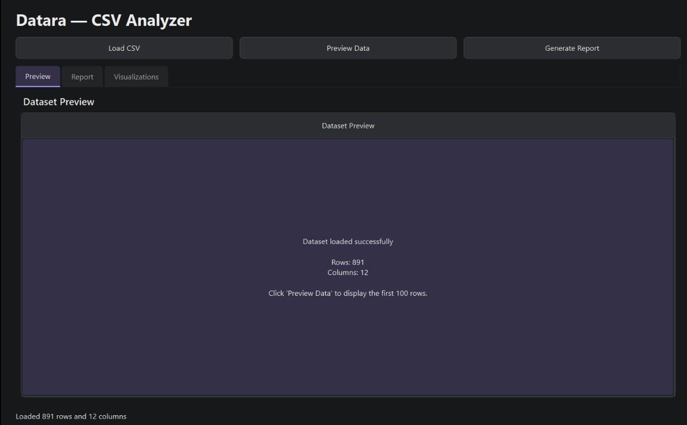
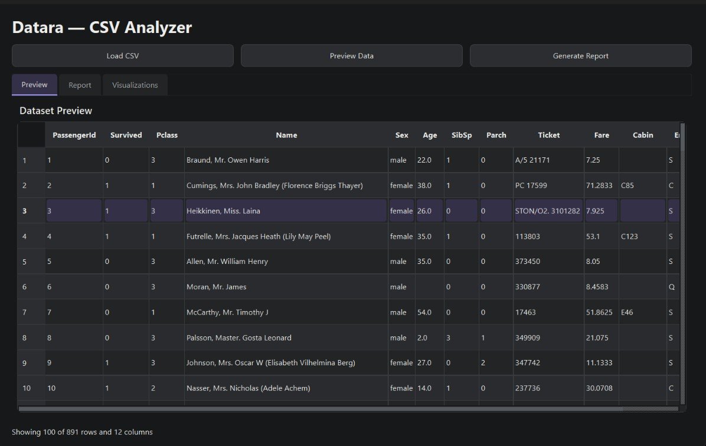
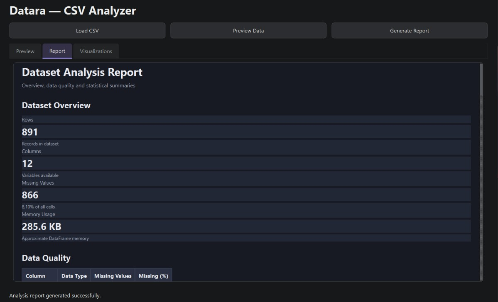
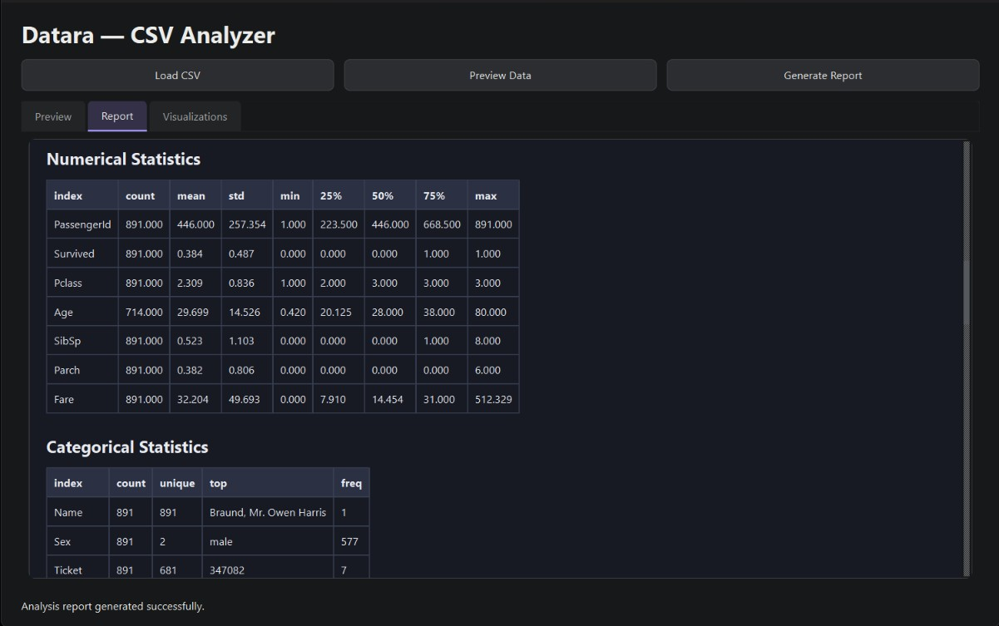
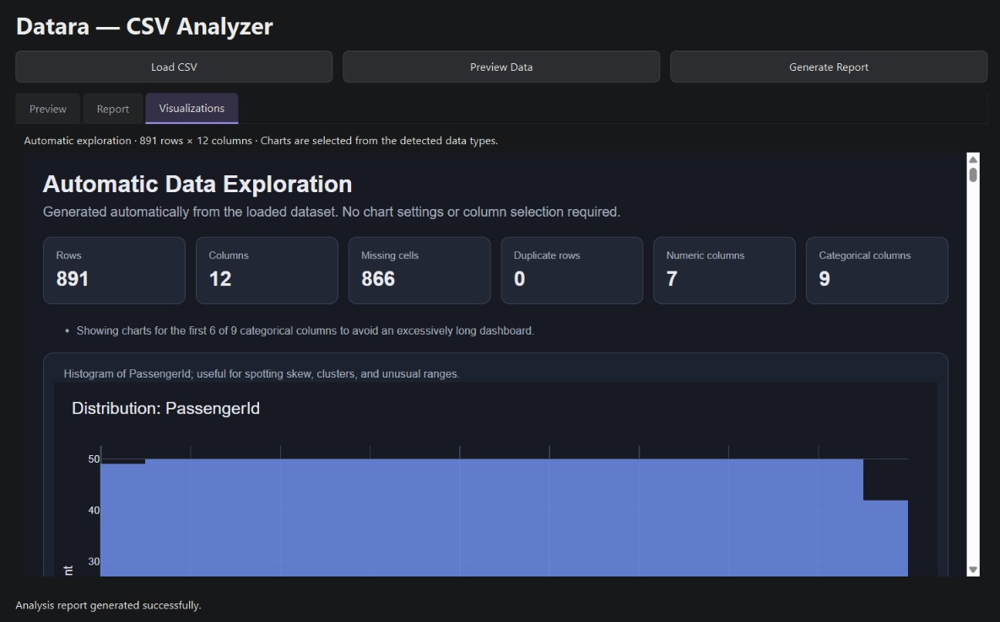
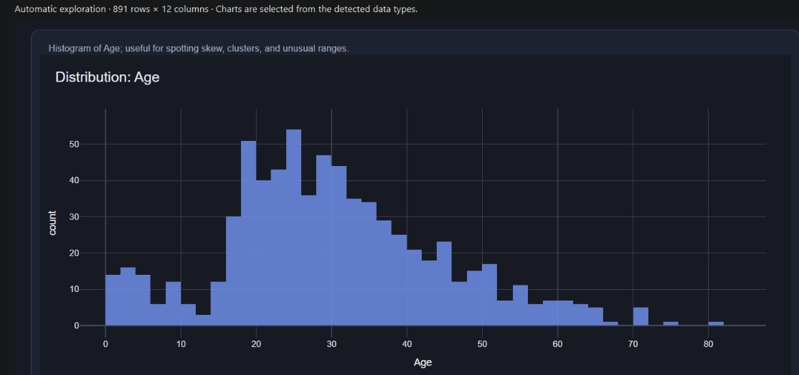
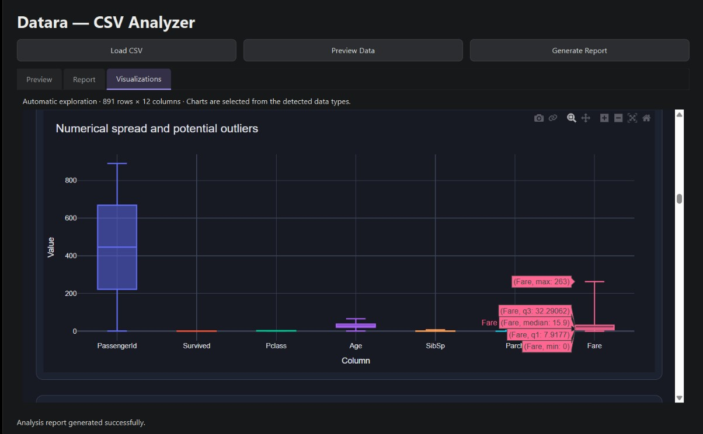
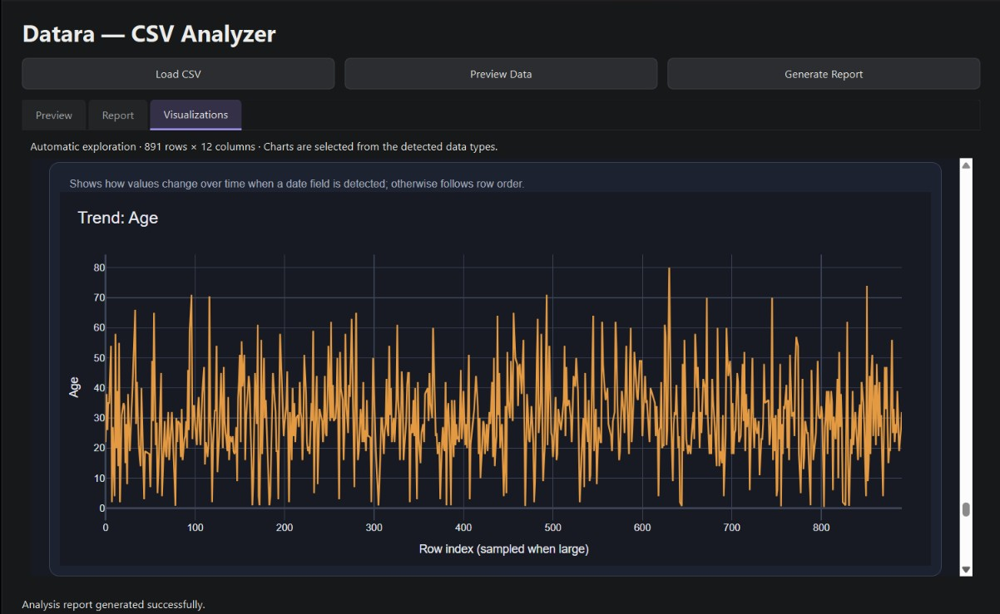
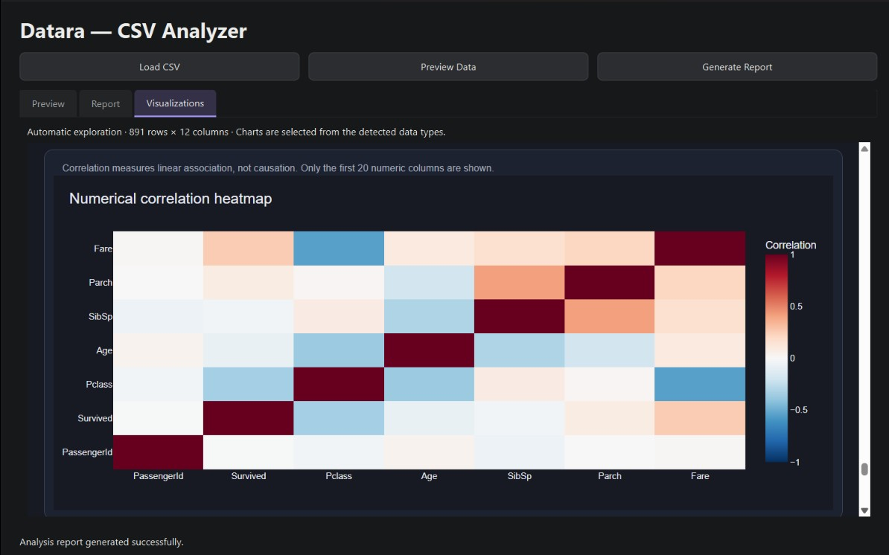

# Datara

### Explore Your Data. Visualize Patterns. Discover Insights.

**Datara** is a desktop data analysis and visualization application designed to make tabular data easier to explore and understand. It provides a streamlined workspace for importing datasets, inspecting data, creating interactive visualizations, and generating reports through a clean, dark-themed interface.

## Features

- **Data Import & Exploration** — Load and preview CSV, TSV, and TXT files.
- **Data Analysis** — Explore datasets using the application's built-in analysis features.
- **Interactive Visualizations** — Create Plotly-powered charts to identify patterns, trends, distributions, and relationships.
- **Report Generation** — Generate reports to organize and review analytical results.
- **Dark-Themed Interface** — Analyze data in a clean, focused desktop workspace.
- **Simple Installation** — Install Datara on Windows without manually configuring Python or its dependencies.

## Visualizations

Datara's visualization capabilities help transform raw data into more understandable graphical representations. Depending on the chart options available, these may include:

- **Bar Charts** — Compare values across categories.
- **Line Charts** — Examine trends and changes over ordered data.
- **Scatter Plots** — Investigate relationships between numerical variables.
- **Histograms** — Understand numerical data distributions.
- **Pie Charts** — Visualize proportions across categories.
- **Box Plots** — Examine data spread and potential outliers.

## How It Works

1. **Import** — Open a CSV, TSV, or TXT dataset.
2. **Explore** — Preview and inspect the data.
3. **Analyze** — Use the available analysis features.
4. **Visualize** — Generate interactive charts.
5. **Report** — Generate reports from your analysis workflow.

## Installation

### Windows

1. Visit the [Datara Releases](https://github.com/bhavyasahni123/Csv_analyzer/releases) page.
2. Download the latest **Datara Setup `.exe`** from the release assets.
3. Run the installer and follow the on-screen instructions.
4. Launch Datara from the Start Menu or desktop shortcut.

No separate Python installation or manual dependency setup is required.

## Technology Stack

- **Python** — Core application logic
- **PyQt6** — Desktop user interface
- **Pandas** — Tabular data handling
- **Plotly** — Interactive visualizations

## Preview

## Author

**Bhavya Sahni**

---

*Datara — Your data, made clearer.*
